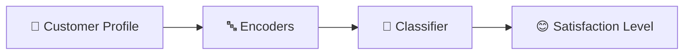

<div align="center">


<b><i>Understanding and predicting online-shopper behaviour</i></b>


      

   
</div>

---

## 🛒 About the Project

Based on the research paper *“Cross-Border E-Commerce User Behaviour Analysis Algorithm Based on Machine Learning”*, this project analyses **online-shopper behaviour** — age, gender, city, membership type, spend, items purchased, ratings and more — and predicts **customer satisfaction** through a Flask web app.

## ✨ Key Features

- 📊 EDA of the *E-commerce Customer Behaviour* dataset
- 🔤 Label encoders for gender, city, membership & satisfaction
- 🤖 Trained classification model (`model.pkl`)
- 🌐 Single-page Flask UI for instant prediction
- 📄 Abstract, base paper and full project report included

## 🧠 How It Works



## 🛠️ Tech Stack

| Layer | Technology |
|---|---|
| Language | Python 3 |
| Data & ML | Pandas · NumPy · scikit-learn |
| Notebook | Jupyter |
| Web App | Flask + Jinja2 templates |
| Frontend | HTML5 · CSS3 |

## 📂 Project Structure

```text
├── abstract/          # project abstract (.docx)
├── basepaper/         # reference paper (B21.pdf)
├── full document/     # complete report
└── code/Ecommerce Customer Behaviour/
    ├── app.py
    ├── customer behaviour.ipynb
    ├── E-commerce Customer Behavior - Sheet1.csv
    ├── model.pkl + *_encoder.pkl
    ├── static/style.css
    └── templates/index.html
```

## 🚀 Getting Started

```bash
git clone https://github.com/PreciousBharath/CUSTOMER-BEHAVIOUR-FOR-E-COMMERCE.git
cd "CUSTOMER-BEHAVIOUR-FOR-E-COMMERCE/code/Ecommerce Customer Behaviour"
pip install flask pandas numpy scikit-learn
python app.py
```

## 🤝 Contributing

Contributions, issues and feature requests are welcome! Feel free to ⭐ star the repo and open a pull request.

## 👨‍💻 Author

<div align="center">

**Bharath** — Software Developer · Project Engineer · Technical Trainer

<a href="https://github.com/PreciousBharath"></a>
<a href="https://linkedin.com/in/connectbharath"></a>

### 🍔 EAT · 😴 SLEEP · 💻 CODE · 🔁 REPEAT

⭐ **If you found this project useful, give it a star!** ⭐


</div>
